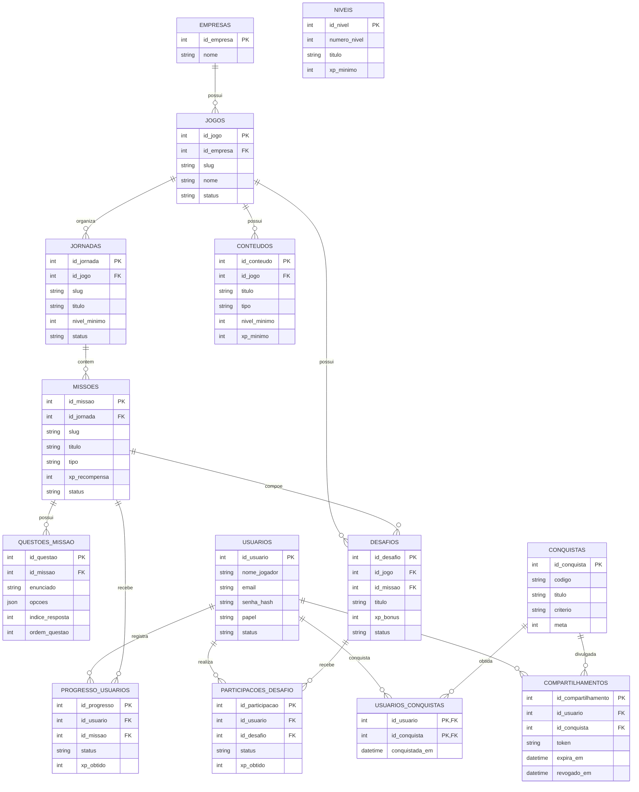

# Diagrama Entidade-Relacionamento (DER)

Diagrama das tabelas de negócio da migração inicial. A notação `||` indica exatamente um; `o{` indica zero ou muitos. PK representa chave primária e FK chave estrangeira. Os atributos completos, tipos, índices e restrições estão em [modelagem-logica.md](modelagem-logica.md).

`NIVEIS` é independente no esquema físico: os níveis são calculados usando os limites de XP, sem chave estrangeira para usuários.
