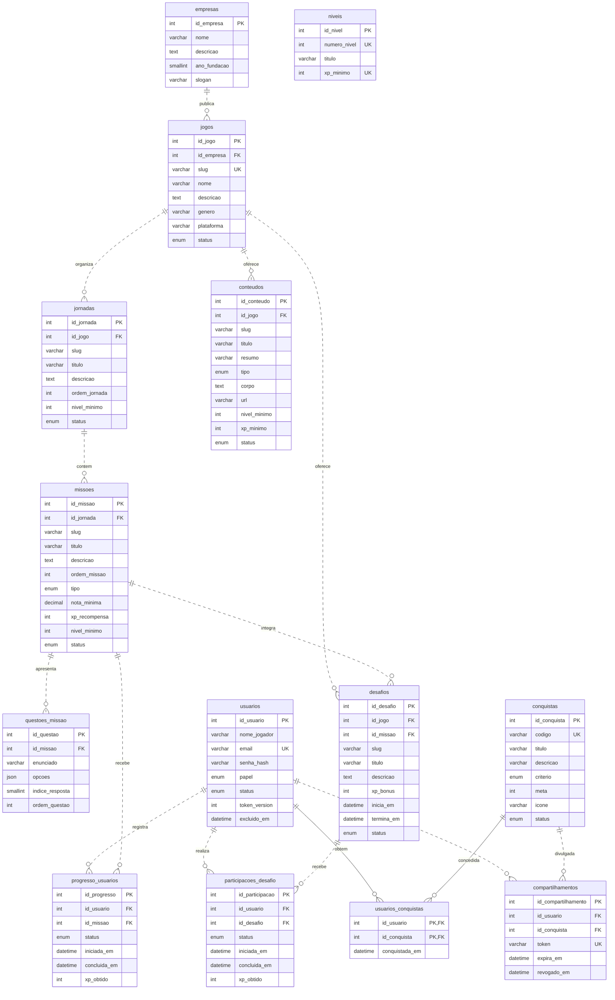

# Diagrama Entidade-Relacionamento (DER)

O diagrama representa as 14 tabelas de negócio. Cada ligação indica que um registro da tabela à esquerda pode ter zero ou muitos registros à direita e que cada registro à direita aponta para exatamente um à esquerda. A linha contínua indica que a referência integra a chave primária da tabela dependente.

**PK** indica chave primária, **FK** indica chave estrangeira e **UK** indica unicidade em uma única coluna. Em `usuarios_conquistas`, as duas colunas marcadas como PK formam uma chave composta. Todas as tabelas também registram `criado_em` e `atualizado_em`.

A aplicação consulta `niveis` por XP, por isso a tabela aparece isolada. Os compartilhamentos usam chaves separadas para o usuário e a conquista. A validação da posse da conquista fica na API.

[Modelo conceitual](modelagem-conceitual.md) · [Modelo lógico com campos opcionais, chaves e índices compostos](modelagem-logica.md)
